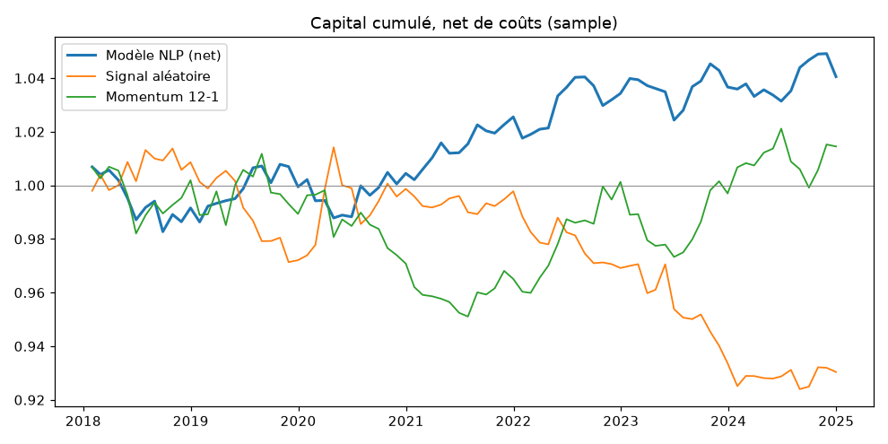
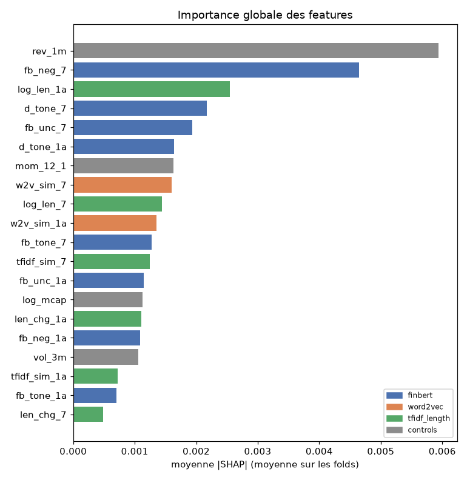
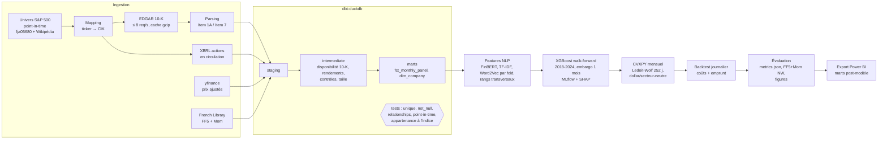

# PortfolioIQ

**Stratégie long-short dollar- et secteur-neutre sur le S&P 500, pilotée par le texte des 10-K (FinBERT, « Lazy Prices », Word2Vec) et un XGBoost walk-forward, avec univers point-in-time sans biais du survivant.**

> ⚠️ **Run publié = `sample` (50 tickers, ≈ 30 titres investissables par mois).** Le run `full` (`RUN_SCALE=full`, univers complet ≈ 900 tickers) n'a pas encore été exécuté (`.\tasks.ps1 full`). Les chiffres ci-dessous valident la chaîne de bout en bout mais **ne mesurent pas la performance de la stratégie** sur l'univers complet. Voir [Limites](#données-et-limites).

## Résultats

Tous les chiffres de cette section sont insérés automatiquement depuis `reports/metrics.json` par `python -m portfolioiq.cli update-docs` (appelé à la fin de l'étape `evaluate`).

<!-- metrics:start -->
*Run `sample` — période hors échantillon 2018-01 → 2024-12, nets de 10.0 bps/côté et 50.0 bps/an d'emprunt. Généré le 2026-10-19T16:29:07.*

| Métrique | Modèle NLP | Signal aléatoire | Momentum 12-1 |
|---|---:|---:|---:|
| Rendement annualisé (net) | 0.6 % | -1.0 % | 0.2 % |
| Volatilité annualisée | 1.7 % | 2.2 % | 2.4 % |
| Sharpe (net) | 0.34 | -0.46 | 0.10 |
| Sortino | 0.51 | -0.61 | 0.14 |
| Max drawdown | -2.4 % | -8.9 % | -6.0 % |
| Taux de mois positifs | 59.5 % | 44.0 % | 48.8 % |
| Turnover mensuel moyen (Σ|Δw|) | 19.4 % | 44.6 % | 10.6 % |
| Exposition brute moyenne | 0.41 | 0.41 | 0.41 |
| Sharpe brut (avant coûts) | 0.54 | -0.17 | 0.20 |
| Alpha FF5+Mom annualisé | 0.48 % | -0.84 % | 0.04 % |
| t-stat Newey-West (6 lags) | 0.85 | -1.25 | 0.07 |
| R² FF5+Mom | 0.09 | 0.05 | 0.35 |
| Nombre de mois | 84 | 84 | 84 |

**IC de Spearman mensuel** (prédiction vs rendement du mois suivant) : moyenne 0.0270, t-stat 1.24, 84 mois, 58 % de mois positifs.

| Année | 2018 | 2019 | 2020 | 2021 | 2022 | 2023 | 2024 |
|---|---:|---:|---:|---:|---:|---:|---:|
| IC moyen | -0.021 | 0.065 | -0.044 | 0.049 | 0.048 | 0.049 | 0.043 |

**Robustesse**

| Variante | Rendement ann. | Sharpe | Alpha FF ann. | t NW | IC moyen |
|---|---:|---:|---:|---:|---:|
| Référence (10 bps) | 0.6 % | 0.34 | 0.48 % | 0.85 | 0.0270 |
| Coûts 5 bps | 0.8 % | 0.45 | 0.62 % | 1.08 | — |
| Coûts 20 bps | 0.1 % | 0.04 | 0.07 % | 0.12 | — |
| Sous-période 2018-01 → 2020-12 | 0.1 % | 0.09 | 0.82 % | 0.70 | — |
| Sous-période 2021-01 → 2024-12 | 0.9 % | 0.58 | 0.71 % | 1.55 | — |
| Sans Word2Vec | 0.6 % | 0.33 | 0.16 % | 0.26 | 0.0116 |
| Sans FinBERT | 0.8 % | 0.39 | 0.37 % | 0.65 | 0.0282 |
<!-- metrics:end -->





Autres figures : [drawdown](reports/figures/drawdown.png), [IC par année](reports/figures/ic_by_year.png), [beeswarm SHAP (dernier fold)](reports/figures/shap_beeswarm.png), [stabilité des importances entre folds](reports/figures/shap_stability.png), beeswarms par fold dans `reports/figures/folds/`.

### Lecture des résultats

Les objectifs visés (Sharpe ≈ 1,15 ; alpha FF ≈ 3,2 %/an ; t ≈ 1,85) **ne sont pas atteints** sur le run `sample`, et aucun hyperparamètre n'a été ajusté pour s'en rapprocher (grilles et paramètres de portefeuille fixés a priori, voir `docs/DECISIONS.md`). Lecture honnête :

- **Aucun résultat n'est statistiquement significatif** : la t-stat Newey-West de l'alpha et celle de l'IC sont proches de zéro. Avec ≈ 30 titres par mois répartis sur 12 secteurs, la neutralité sectorielle laisse très peu de paris et l'IC mensuel est très bruité (écart-type de l'ordre de 0,2).
- **Exposition faible** : avec ≈ 30 titres, `|wᵢ| ≤ 2 %` et la neutralité sectorielle (un secteur représenté par un seul titre impose un poids nul), le levier brut atteignable est bien inférieur à 2 ; les trois stratégies butent sur ces bornes, d'où la même exposition brute moyenne. Les rendements absolus sont donc minuscules : le Sharpe et les t-stats, invariants à l'échelle, sont les indicateurs pertinents.
- **Benchmarks** : le modèle fait mieux que le signal aléatoire (qui perd à peu près ses coûts de rotation, comme attendu) et que le momentum simple sur l'échantillon, mais l'écart n'est pas significatif.
- **Coûts** : le résultat est sensible aux coûts (le Sharpe devient quasi nul à 20 bps par côté).
- **Ablations et sous-périodes** : retirer Word2Vec ou FinBERT ne change presque pas le Sharpe ; l'IC baisse sans Word2Vec et reste stable sans FinBERT. La sous-période 2021-2024 est meilleure que 2018-2020. Sur ≈ 30 titres, ces écarts sont dans le bruit et ne permettent pas de conclure sur l'apport de chaque bloc ; il faut le run `full` pour cela.
- **Fragilité** : avant de rendre le pipeline déterministe (ordre des lignes DuckDB, Word2Vec mono-thread), des runs identiques donnaient un Sharpe net entre ≈ 0,27 et ≈ 0,56 selon le seul ordre des lignes. Cet écart, du même ordre que le résultat lui-même, confirme que le run `sample` n'a pas de pouvoir statistique. Le run publié est déterministe (deux exécutions successives donnent un `metrics.json` identique).

## Architecture



Le même enchaînement est exposé par la CLI (`python -m portfolioiq.cli run-all`) et par le DAG Airflow `portfolioiq_pipeline` (`ingest_universe → ingest_filings → ingest_prices → ingest_factors → dbt_run → dbt_test → build_features → train_walkforward → backtest → evaluate → export_powerbi`), qui appellent les mêmes fonctions (`src/portfolioiq/pipeline.py`).

## Méthodologie

Détails complets : [`docs/METHODOLOGY.md`](docs/METHODOLOGY.md) ; choix et justifications : [`docs/DECISIONS.md`](docs/DECISIONS.md).

**Biais du survivant.** À chaque fin de mois, l'univers est la composition de l'indice **à cette date** (instantanés historiques), y compris les titres ensuite rachetés, sortis ou en faillite. Le mapping ticker → CIK utilise aussi les noms des titres sortis (recherche EDGAR) et vérifie que le CIK a bien déposé des 10-K pendant la période d'appartenance. Une règle de délisting explicite (0 % en cas de rachat, −30 % sinon, configurable) s'applique quand une série de prix s'arrête. Un test dbt vérifie que chaque ligne du panel appartient à l'indice à sa date.

**Biais d'anticipation.**
- Un 10-K n'est utilisable qu'à partir du premier jour de bourse **strictement après** sa date d'acceptation EDGAR (test dbt `feature_available_date > filing_acceptance_datetime` sur toutes les lignes, et test pytest).
- Actions en circulation XBRL prises à leur date de dépôt (`filed`), jamais à leur date de clôture.
- Word2Vec et son IDF sont réentraînés à chaque fold sur les seuls documents disponibles avant le début du fold (test pytest dédié) ; la similarité TF-IDF n'utilise que la paire de documents comparés.
- Walk-forward à fenêtre expansive (2018 → 2024) avec embargo d'un mois ; hyperparamètres choisis par validation temporelle **interne** à la fenêtre d'entraînement.
- Les paramètres de portefeuille (λ, κ, IC a priori, bornes) sont fixés a priori.

## Données et limites

<!-- data:start -->
*Statistiques du run `sample` (lues dans `reports/metrics.json`).*

| Indicateur | Valeur |
|---|---:|
| Tickers de l'univers historique traités | 50 |
| Taux de mapping ticker → CIK (tickers) | 90.0 % |
| Taux de mapping pondéré par jours d'appartenance | 92.4 % |
| … via table Wikipédia / `company_tickers.json` / recherche EDGAR par nom | 31 / 6 / 8 (non mappés : 5) |
| 10-K sélectionnés | 546 |
| Taux de téléchargement | 100.0 % |
| Extraction Item 1A réussie | 94.7 % |
| Extraction Item 7 réussie | 88.3 % |
| Extraction des deux items | 86.6 % |
| Couverture prix — tickers avec historique (yfinance) | 70.0 % (35/50) |
| Couverture prix — jours d'appartenance couverts | 76.1 % |
| Couverture prix — titres sortis de l'indice avant fin 2024 | 31.6 % (sur 19) |
| Sociétés avec actions en circulation XBRL | 91.1 % |
<!-- data:end -->

Limites à garder en tête :

1. **Run `sample` seulement** (voir l'avertissement en tête) : ≈ 30 titres investissables par mois, résultats non représentatifs et non significatifs.
2. **Couverture des titres disparus** : `yfinance` ne fournit pas l'historique de la plupart des titres délistés ; ceux-ci restent dans l'univers point-in-time mais ne sont pas investissables faute de prix. Le biais du survivant est donc réduit mais **pas éliminé**. Correctif prévu : `prices.source: tiingo` ou `crsp_csv`.
3. **Titres sans CIK** : exclus de l'univers investissable (ni texte ni secteur).
4. **Secteurs** : 12 industries Fama-French à partir du SIC courant (proxy de GICS, non historisé).
5. **Coûts supposés** : 10 bps par côté + 50 bps/an d'emprunt sur la jambe short, sans impact de marché ni contraintes de disponibilité des titres à emprunter. Sensibilité à 5 et 20 bps fournie.
6. **Budget FinBERT** : 16 phrases échantillonnées par item en `sample`, 64 en `full` (débit mesuré ≈ 38 phrases/s sur ce CPU 8 cœurs avec quantification int8 ; le run `full`, ≈ 9 000 10-K, représente de l'ordre de 8 h de FinBERT).
7. **Sortie de l'indice ≠ délisting** : la règle de délisting ne s'applique que si la série de prix s'arrête ; un titre sorti mais toujours coté est simplement retiré de l'univers.

## Reproduire

Prérequis : Windows, Python 3.11 (`py -3.11`), Docker Desktop (optionnel, pour Airflow). Créer `.env` à partir de `.env.example` (`SEC_USER_AGENT="Prénom Nom email"`).

```powershell
.\tasks.ps1 setup        # venv .venv, torch CPU, dépendances (pyproject.toml)
.\.venv\Scripts\Activate.ps1
.\tasks.ps1 test         # pytest (hors réseau) + ruff
.\tasks.ps1 sample       # ~50 tickers, toutes les étapes ; ≈ 20 min au premier passage, ≈ 5 min avec cache
.\tasks.ps1 full         # univers complet (plusieurs heures ; reprend sur cache en cas d'interruption)
.\tasks.ps1 mlflow-ui    # http://localhost:5000 (runs parent + folds, modèles, figures SHAP)
.\tasks.ps1 airflow-validate   # parse le DAG dans le conteneur officiel (list-import-errors + arbre des tâches)
.\tasks.ps1 airflow-up         # Airflow standalone sur http://localhost:8080
.\tasks.ps1 secrets            # detect-secrets scan
```

Reprendre une étape : `python -m portfolioiq.cli run-all --config configs\sample.yaml --from-step build_features`. Chaque étape est idempotente (cache disque) ; les logs JSON structurés sont dans `logs/`.

Pour lancer le DAG dans Airflow, les dépendances du projet doivent être présentes dans le conteneur : définir `PIQ_PIP_REQUIREMENTS` dans `.env` (installation au démarrage, usage de développement) ou construire une image dérivée. La validation du DAG (`airflow-validate`) n'en a pas besoin : les imports lourds sont faits dans les tâches.

## Structure du projet

```
src/portfolioiq/
  config.py, cli.py, pipeline.py, utils.py
  ingestion/   universe.py, edgar.py, parsing.py, prices.py, factors.py, sectors.py
  nlp/         finbert.py, word2vec.py, similarity.py, features.py
  models/      walkforward.py, xgb.py, shap_analysis.py
  portfolio/   risk.py, optimizer.py, costs.py, backtest.py
  evaluation/  metrics.py, fama_french.py, reports.py, readme.py
  tracking/    mlflow_utils.py
dbt/           staging/, intermediate/, marts/, tests/ (point-in-time, appartenance à l'indice)
dags/          portfolioiq_dag.py
configs/       default.yaml (full), sample.yaml
tests/         pytest, données synthétiques, sans réseau
powerbi/       README.md (modèle de données, pages, mesures DAX)
reports/       metrics.json, figures/ (versionnés) ; *.parquet ignorés
docs/          PLAN.md, DECISIONS.md, METHODOLOGY.md, DATA.md
```

## Power BI

`export_powerbi` écrit les marts (`dim_company`, `fct_monthly_panel`, `fct_backtest_returns`, `fct_shap_importance`) en CSV dans `powerbi/data/`. Le guide [`powerbi/README.md`](powerbi/README.md) décrit le modèle de données, trois pages (performance, risque/expositions, explicabilité SHAP) et les mesures DAX.

## Pistes d'amélioration

- Exécuter le run `full` et, idéalement, passer à `tiingo` ou à un export CRSP pour couvrir les titres délistés.
- Mapping CIK des titres disparus via un historique de tickers (CRSP/Compustat) plutôt que par nom.
- Secteurs GICS historiques, actions en circulation avant 2009 (CRSP).
- FinBERT sur l'intégralité des phrases (GPU) et dictionnaire Loughran-McDonald en complément.
- Modèle de risque factoriel (Barra-like) et coûts dépendant de la liquidité ; contrainte de beta-neutralité.
- Calibration de λ et de l'IC a priori par validation interne (et non sur la période de test).

## Avertissement

Projet de recherche et de démonstration technique. **Ceci n'est pas un conseil en investissement.** Les performances passées, a fortiori simulées, ne préjugent pas des performances futures.
