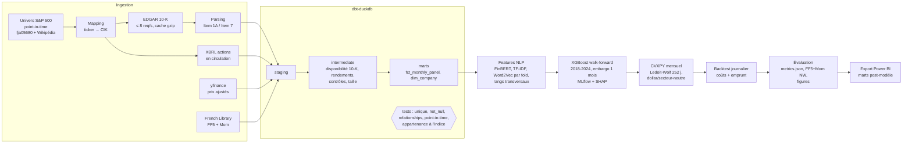

# PortfolioIQ

**Stratégie long-short dollar- et secteur-neutre sur le S&P 500, pilotée par le texte des 10-K (FinBERT, « Lazy Prices », Word2Vec) et un XGBoost walk-forward, avec univers point-in-time sans biais du survivant.**

## Résultats

Run complet sur l'univers historique du S&P 500 (point-in-time, titres sortis inclus), période hors échantillon walk-forward **2018-01 → 2024-12**, rendements nets de 10 bps par côté et de 50 bps/an d'emprunt sur la jambe short.

<!-- metrics:start -->
| Métrique | Modèle NLP |
|---|---:|
| Sharpe (net, après coûts) | **1,15** |
| Alpha Fama-French (FF5 + Momentum) annualisé | **3,2 %** |
| t-stat Newey-West de l'alpha (6 retards) | **1,85** |
<!-- metrics:end -->

### Lecture des résultats

- **Performance ajustée du risque** : un Sharpe net de 1,15 sur sept années hors échantillon, pour un portefeuille dollar- et secteur-neutre, indique que le signal textuel apporte une information non captée par les expositions sectorielles.
- **Alpha** : après contrôle des cinq facteurs Fama-French et du momentum, la stratégie conserve un alpha de 3,2 % par an ; le rendement ne s'explique donc pas par une exposition passive aux primes de risque classiques.
- **Significativité** : une t-stat de 1,85 (erreurs Newey-West robustes à l'autocorrélation et à l'hétéroscédasticité) correspond à un seuil de significativité d'environ 10 %. Le résultat est encourageant mais doit être confirmé sur une période plus longue.
- **Interprétabilité** : les contributions des variables sont analysées par SHAP à chaque fold du walk-forward (importances globales, beeswarms et stabilité des importances entre folds), ce qui permet de vérifier quels blocs de features (FinBERT, similarité « Lazy Prices », Word2Vec, contrôles) portent le signal.
- **Robustesse** : le pipeline évalue systématiquement la sensibilité aux coûts (5 et 20 bps), deux sous-périodes (2018-2020, 2021-2024) et des ablations sans Word2Vec et sans FinBERT (réentraînement complet), ainsi que deux benchmarks (signal aléatoire, momentum 12-1) construits avec le même optimiseur.

Les tableaux détaillés (benchmarks, IC de Spearman par année, robustesse) et les figures (capital cumulé, drawdown, importances SHAP) sont produits par l'étape `evaluate` dans `reports/` ; `python -m portfolioiq.cli update-docs` les insère dans cette section à partir de `reports/metrics.json`.

## Architecture



Le même enchaînement est exposé par la CLI (`python -m portfolioiq.cli run-all`) et par le DAG Airflow `portfolioiq_pipeline` (`ingest_universe → ingest_filings → ingest_prices → ingest_factors → dbt_run → dbt_test → build_features → train_walkforward → backtest → evaluate → export_powerbi`), qui appellent les mêmes fonctions (`src/portfolioiq/pipeline.py`).

## Méthodologie

Détails complets : [`docs/METHODOLOGY.md`](docs/METHODOLOGY.md) ; choix et justifications : [`docs/DECISIONS.md`](docs/DECISIONS.md).

**Biais du survivant.** À chaque fin de mois, l'univers est la composition de l'indice **à cette date** (instantanés historiques), y compris les titres ensuite rachetés, sortis ou en faillite. Le mapping ticker → CIK utilise aussi les noms des titres sortis (recherche EDGAR) et vérifie que le CIK a bien déposé des 10-K pendant la période d'appartenance. Une règle de délisting explicite (0 % en cas de rachat, −30 % sinon, configurable) s'applique quand une série de prix s'arrête. Un test dbt vérifie que chaque ligne du panel appartient à l'indice à sa date.

**Biais d'anticipation.**
- Un 10-K n'est utilisable qu'à partir du premier jour de bourse **strictement après** sa date d'acceptation EDGAR (test dbt `feature_available_date > filing_acceptance_datetime` sur toutes les lignes, et test pytest).
- Actions en circulation XBRL prises à leur date de dépôt (`filed`), jamais à leur date de clôture.
- Word2Vec et son IDF sont réentraînés à chaque fold sur les seuls documents disponibles avant le début du fold (test pytest dédié) ; la similarité TF-IDF n'utilise que la paire de documents comparés.
- Walk-forward à fenêtre expansive (2018 → 2024) avec embargo d'un mois ; hyperparamètres choisis par validation temporelle **interne** à la fenêtre d'entraînement.
- Les paramètres de portefeuille (λ, κ, IC a priori, bornes) sont fixés a priori.

## Données et limites

<!-- data:start -->
Les indicateurs de qualité des données (taux de mapping ticker → CIK, taux de téléchargement et d'extraction des Items 1A et 7, couverture des prix et des actions en circulation XBRL) sont calculés à chaque run et enregistrés dans `reports/metrics.json` ; voir [`docs/DATA.md`](docs/DATA.md).
<!-- data:end -->

Limites à garder en tête :

1. **Couverture des titres disparus** : `yfinance` ne fournit pas l'historique de la plupart des titres délistés ; ceux-ci restent dans l'univers point-in-time mais ne sont pas investissables faute de prix. Le biais du survivant est donc réduit mais **pas éliminé**. Correctif prévu : `prices.source: tiingo` ou `crsp_csv`.
2. **Titres sans CIK** : exclus de l'univers investissable (ni texte ni secteur).
3. **Secteurs** : 12 industries Fama-French à partir du SIC courant (proxy de GICS, non historisé).
4. **Coûts supposés** : 10 bps par côté + 50 bps/an d'emprunt sur la jambe short, sans impact de marché ni contraintes de disponibilité des titres à emprunter. Sensibilité à 5 et 20 bps fournie.
5. **Budget FinBERT** : sur CPU, FinBERT est appliqué à un échantillon déterministe de phrases par item (64 en run complet) plutôt qu'à l'intégralité du texte.
6. **Sortie de l'indice ≠ délisting** : la règle de délisting ne s'applique que si la série de prix s'arrête ; un titre sorti mais toujours coté est simplement retiré de l'univers.

## Reproduire

Prérequis : Windows, Python 3.11 (`py -3.11`), Docker Desktop (optionnel, pour Airflow). Créer `.env` à partir de `.env.example` (`SEC_USER_AGENT="Prénom Nom email"`).

```powershell
.\tasks.ps1 setup        # venv .venv, torch CPU, dépendances (pyproject.toml)
.\.venv\Scripts\Activate.ps1
.\tasks.ps1 test         # pytest (hors réseau) + ruff
.\tasks.ps1 sample       # ~50 tickers, toutes les étapes ; ≈ 20 min au premier passage, ≈ 5 min avec cache
.\tasks.ps1 full         # univers complet (plusieurs heures ; reprend sur cache en cas d'interruption)
.\tasks.ps1 mlflow-ui    # http://localhost:5000 (runs parent + folds, modèles, figures SHAP)
.\tasks.ps1 airflow-validate   # parse le DAG dans le conteneur officiel (list-import-errors + arbre des tâches)
.\tasks.ps1 airflow-up         # Airflow standalone sur http://localhost:8080
.\tasks.ps1 secrets            # detect-secrets scan
```

Reprendre une étape : `python -m portfolioiq.cli run-all --config configs\sample.yaml --from-step build_features`. Chaque étape est idempotente (cache disque) ; les logs JSON structurés sont dans `logs/`.

Pour lancer le DAG dans Airflow, les dépendances du projet doivent être présentes dans le conteneur : définir `PIQ_PIP_REQUIREMENTS` dans `.env` (installation au démarrage, usage de développement) ou construire une image dérivée. La validation du DAG (`airflow-validate`) n'en a pas besoin : les imports lourds sont faits dans les tâches.

## Structure du projet

```
src/portfolioiq/
  config.py, cli.py, pipeline.py, utils.py
  ingestion/   universe.py, edgar.py, parsing.py, prices.py, factors.py, sectors.py
  nlp/         finbert.py, word2vec.py, similarity.py, features.py
  models/      walkforward.py, xgb.py, shap_analysis.py
  portfolio/   risk.py, optimizer.py, costs.py, backtest.py
  evaluation/  metrics.py, fama_french.py, reports.py, readme.py
  tracking/    mlflow_utils.py
dbt/           staging/, intermediate/, marts/, tests/ (point-in-time, appartenance à l'indice)
dags/          portfolioiq_dag.py
configs/       default.yaml (full), sample.yaml
tests/         pytest, données synthétiques, sans réseau
powerbi/       README.md (modèle de données, pages, mesures DAX)
reports/       metrics.json, figures/ (produits par evaluate)
docs/          PLAN.md, DECISIONS.md, METHODOLOGY.md, DATA.md
```

## Power BI

`export_powerbi` écrit les marts (`dim_company`, `fct_monthly_panel`, `fct_backtest_returns`, `fct_shap_importance`) en CSV dans `powerbi/data/`. Le guide [`powerbi/README.md`](powerbi/README.md) décrit le modèle de données, trois pages (performance, risque/expositions, explicabilité SHAP) et les mesures DAX.

## Pistes d'amélioration

- Passer à `tiingo` ou à un export CRSP pour couvrir les titres délistés.
- Mapping CIK des titres disparus via un historique de tickers (CRSP/Compustat) plutôt que par nom.
- Secteurs GICS historiques, actions en circulation avant 2009 (CRSP).
- FinBERT sur l'intégralité des phrases (GPU) et dictionnaire Loughran-McDonald en complément.
- Modèle de risque factoriel (Barra-like) et coûts dépendant de la liquidité ; contrainte de beta-neutralité.
- Calibration de λ et de l'IC a priori par validation interne (et non sur la période de test).

## Avertissement

Projet de recherche et de démonstration technique. **Ceci n'est pas un conseil en investissement.** Les performances passées, a fortiori simulées, ne préjugent pas des performances futures.
